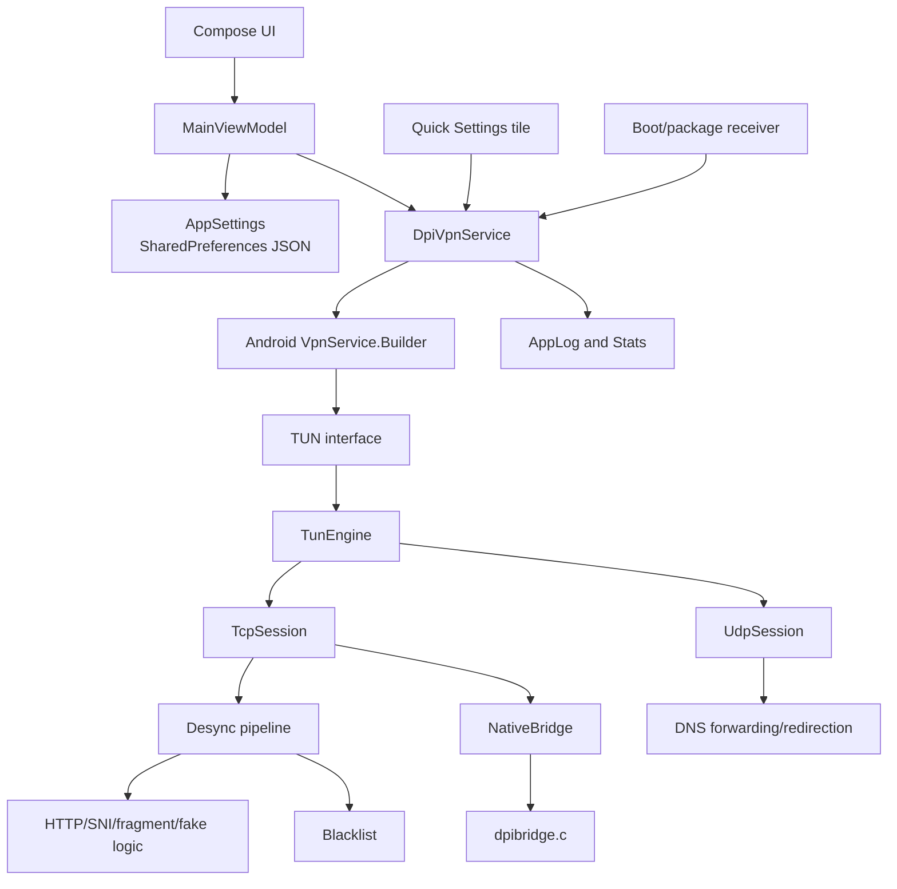
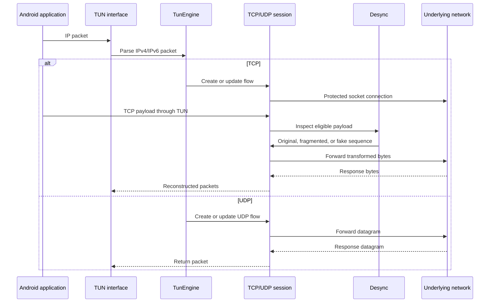

# DPI Akio

DPI Akio is an Android application that adapts the traffic-desynchronisation
techniques from [GoodbyeDPI](ref-goodbyedpi/README.md) to Android devices
without root access. It runs as a local Android VPN, inspects packets through a
TUN interface, and forwards traffic through protected user-space sockets while
applying configurable HTTP/HTTPS, DNS, QUIC, TTL, and packet desynchronisation
strategies.

> **Important:** DPI Akio is a traffic-filtering and desynchronisation tool, not
> a VPN provider or an anonymity network. It does not create an encrypted tunnel
> to a remote server. Traffic still uses the device's current network connection.

## Features

- Android `VpnService` implementation with foreground-service lifecycle.
- Jetpack Compose interface with four areas:
  - Home: connection status, start/stop control, and traffic statistics.
  - Modes: predefined GoodbyeDPI-compatible mode sets and presets.
  - Advanced: individual DPI, DNS, blacklist, IPv6, logging, and fallback TTL
    settings.
  - Logs: runtime diagnostics and packet-processing information.
- User-space TCP and UDP forwarding through a TUN device.
- HTTP request fragmentation and header transformations.
- TLS ClientHello/SNI detection and HTTPS fragmentation.
- GoodbyeDPI-style fake packets using native Android socket helpers.
- Reverse fragmentation, fake TTL, automatic TTL calculation, and minimum TTL
  handling.
- QUIC blocking when configured.
- DNS redirection to configured IPv4/IPv6 resolvers.
- Built-in, downloaded, and user-maintained hostname blacklists.
- Quick Settings tile and optional start-on-boot behavior.
- IPv4 and conditional IPv6 support.
- Unit tests for command-line compatibility and core desynchronisation logic.

## How it works

### High-level architecture



### Startup sequence

1. The user presses the start control, selects the Quick Settings tile, or
   enables automatic startup.
2. `MainActivity` requests notification permission where required and asks
   Android for VPN approval through `VpnService.prepare`.
3. `DpiVpnService` starts as a foreground service and loads the persisted
   `AppConfig`.
4. The selected mode or preset is validated and finalized. Blacklists are
   loaded from app assets or app-private files.
5. `VpnService.Builder` creates a blocking TUN interface:
   - virtual IPv4 address: `198.18.0.1/32`;
   - virtual DNS address: `198.18.0.53`;
   - public IPv4 routes;
   - IPv6 address and route only when enabled and available on the underlying
     network;
   - the DPI Akio package itself is excluded from the VPN to avoid a routing
     loop.
6. `TunEngine` starts its packet reader, TCP/UDP session tables, I/O workers,
   and periodic session timers.
7. The service publishes `RUNNING` state, starts statistics sampling, and
   updates its persistent notification.

### Packet flow



`TunEngine` handles only TCP and UDP packets. Unsupported or malformed packets
are ignored or reset according to the protocol state. TCP sessions implement a
small user-space TCP endpoint and expose a `RemoteWriter` abstraction to the
`Desync` engine. UDP sessions use connected datagram sockets and forward
payloads without TCP-style desynchronisation.

### DNS handling

DNS queries are recognized before normal UDP session dispatch:

1. The engine identifies DNS-shaped UDP or TCP queries on port 53.
2. If the matching DNS redirect option is enabled, it sends the query to the
   configured resolver.
3. Requests addressed to the virtual DNS endpoint are mapped to the real
   resolver while remaining invisible to the application.
4. DNS logging is available through the verbose DNS option.

### Desynchronisation pipeline

The `Desync` class is the core protocol-independent decision layer. For an
eligible connection it can:

- identify HTTP headers and transform the request host/header formatting;
- extract TLS SNI from a ClientHello;
- apply a hostname blacklist before transforming traffic;
- fragment HTTP or HTTPS payloads;
- reverse-fragment the first bytes of a request;
- generate fake HTTP/TLS payloads;
- select a fake TTL from a fixed value, the observed route, or automatic TTL
  calculation;
- limit processing to configured ports or payload sizes.

The implementation intentionally preserves the semantics of the original
GoodbyeDPI options where Android's networking model permits them. Options that
require host-level packet injection or raw packet privileges cannot be reproduced
fully on an unrooted Android device.

### Native fake-packet path

`NativeBridge` loads `libdpibridge.so`, built from
[`dpibridge.c`](app/src/main/jni/dpibridge.c). The native helper uses Linux
`vmsplice`/`splice` and a temporary memory page:

1. Copy the fake payload into an anonymous page.
2. Lower the socket TTL and splice that page into the TCP socket.
3. Wait until the bytes leave the local send queue.
4. Replace the page contents with the real payload.
5. Restore the normal TTL so a retransmission carries the real bytes.

This is a best-effort Android equivalent of GoodbyeDPI fake request mode. If
the native library is unavailable or the operation fails, the Kotlin session
falls back to the supported non-native transformation path and logs the
condition.

Automatic TTL probing uses a protected ICMP/ICMPv6 socket. The socket is
protected with `VpnService.protect`, so the probe does not re-enter the VPN.
The result is cached per destination for ten minutes.

## Source tree

```text
app/src/main/
├── java/com/dpiakio/app/
│   ├── core/
│   │   ├── AppSettings.kt     Persistent app configuration
│   │   ├── DpiOptions.kt      Options, modes, presets, CLI parser
│   │   ├── Desync.kt          GoodbyeDPI-compatible transformation pipeline
│   │   ├── HttpTricks.kt      HTTP and TLS/SNI parsing helpers
│   │   ├── Fakes.kt           Fake packet generation and TTL calculation
│   │   ├── Blacklist.kt       Blacklist storage and hostname matching
│   │   └── AppLog.kt          Log buffer and traffic statistics
│   ├── net/
│   │   ├── TunEngine.kt       TUN reader, dispatch, DNS, TCP/UDP tables
│   │   ├── TcpSession.kt      User-space TCP session and RemoteWriter
│   │   ├── Packet.kt          IP/TCP/UDP parsing and packet construction
│   │   └── NativeBridge.kt    JNI declarations and TTL prober
│   ├── service/
│   │   ├── DpiVpnService.kt   Foreground VPN lifecycle
│   │   └── Receivers.kt       Boot and Quick Settings integrations
│   └── ui/
│       ├── MainActivity.kt    Compose host and navigation
│       ├── MainViewModel.kt   UI state and configuration updates
│       └── screens/           Home, modes, advanced, and log screens
├── jni/
│   ├── dpibridge.c            Native fake-packet and ICMP helpers
│   ├── Android.mk             ndk-build module definition
│   └── Application.mk         ABIs and Android API floor
├── assets/
│   ├── earth_mask.bin         Earth visualization asset
│   └── russia-blacklist.txt   Bundled hostname blacklist
└── AndroidManifest.xml         Permissions and Android components
```

The `ref-goodbyedpi` directory contains the upstream/reference GoodbyeDPI
source and license material used to compare behavior and option semantics. The
Android implementation does not execute the Windows binary.

## Configuration and persistence

`AppConfig` is serialized as JSON into the app's private
`SharedPreferences` entry named `dpiakio`. It contains:

- the complete `DpiOptions` value;
- selected preset and modeset;
- IPv6 preference;
- fallback fake TTL;
- start-on-boot preference;
- verbose logging preference.

Changing a setting updates the state immediately and schedules a delayed
service reload. This avoids restarting the VPN for every individual control
change while keeping the running configuration synchronized with the UI.

The app stores user-created and downloaded blacklist files in its private files
directory. It does not require storage permission.

## Requirements

- Android Studio with Android SDK Platform 37.
- JDK 17.
- Android NDK `28.2.13676358`.
- Gradle 9.6 (the included wrapper downloads the correct distribution).
- A device or emulator running Android API 28 or newer.
- A device that permits Android VPN applications. VPN approval is required on
  the first run.

The application is configured for these ABIs:

`arm64-v8a`, `armeabi-v7a`, `x86_64`, and `x86`.

## Build and test

From the project root on Windows PowerShell:

```powershell
.\gradlew.bat assembleDebug
.\gradlew.bat testDebugUnitTest
```

The debug APK is written under:

```text
app\build\outputs\apk\debug\app-debug.apk
```

For a release build:

```powershell
.\gradlew.bat assembleRelease
```

The current release configuration enables R8/resource shrinking and uses the
debug signing configuration so the APK can be sideloaded for development. It
is not a production signing setup; replace it with a private release keystore
before publishing.

## Permissions and Android behavior

The manifest declares permissions for:

- Internet and network state access;
- foreground VPN service operation;
- notifications;
- boot/package-replacement startup;
- optional battery-optimization exemption.

Android displays the standard VPN indicator while the service is active. The
service is marked as a special-use foreground service and keeps a persistent
notification so the user can stop it. Revoking VPN permission, stopping the
service, or changing the active network tears down active sessions safely.

When Wi-Fi and mobile data switch, the service resets sessions because existing
underlying sockets may be bound to the old network. Applications can then
reconnect through the new path.

## Limitations

- No root access is required, but Android's VPN/TUN API does not provide the
  same visibility as Windows WinDivert.
- Passive DPI packet injection and filtering of externally injected RST/302
  packets are not fully available on Android.
- Wrong-checksum and wrong-sequence behavior depends on the native socket path
  and may be skipped when a safe socket-level implementation is unavailable.
- Fake-packet behavior depends on kernel support for the native splice path.
- The app does not provide encryption, anonymity, remote tunneling, or IP
  address masking.
- IPv6 is offered only when the underlying network has usable IPv6; otherwise
  the VPN intentionally prefers IPv4 instead of leaving applications waiting
  on dead IPv6 attempts.
- Battery usage can increase because all selected traffic passes through a
  foreground service and user-space packet/session processing.

## Troubleshooting

### The VPN does not start

- Approve the Android VPN prompt.
- Confirm notification permission on Android 13 and newer.
- Check the Log screen for option-validation or `VpnService.Builder` errors.
- Make sure another always-on VPN or work-profile VPN is not conflicting.

### Connectivity is slow or unavailable

- Start with a conservative preset or a lower modeset.
- Disable fake request mode if the native helper is unavailable.
- Check DNS address and port settings.
- Temporarily disable IPv6 if the current network advertises incomplete IPv6
  connectivity.
- Switch networks once to force old TCP sessions to be reset.

### A blacklist update fails

- Confirm that the device has Internet access outside the VPN.
- The update endpoint must return HTTP 200 and at least one usable hostname.
- The downloaded file is stored privately as
  `russia-blacklist-updated.txt`; retrying replaces it only after a successful
  download.

### Native helper diagnostics

The service logs a warning when `libdpibridge` cannot be loaded. The APK must
contain a native library for the device ABI, and the device kernel must support
the socket operations used by `dpibridge.c`. Non-native transformations remain
available when the helper cannot be used.

## Testing strategy

The current unit tests focus on deterministic core behavior:

- command-line parsing and round trips;
- modeset compatibility;
- automatic TTL calculations;
- HTTP header transformations;
- TLS fake/SNI generation;
- reverse fragmentation;
- blacklist parent-domain matching;
- payload-size limits.

Network behavior depends on the Android VPN and socket stack, so it should also
be verified on a real device or emulator after building the APK. Test changes
to packet handling with logging enabled and confirm that stopping the service
restores normal routing.

## License and attribution

See [`ref-goodbyedpi/LICENSE`](ref-goodbyedpi/LICENSE) for the included
GoodbyeDPI license and [`ref-goodbyedpi/README.md`](ref-goodbyedpi/README.md)
for upstream attribution and project context. Review the licenses of all
third-party Android dependencies before redistribution.
